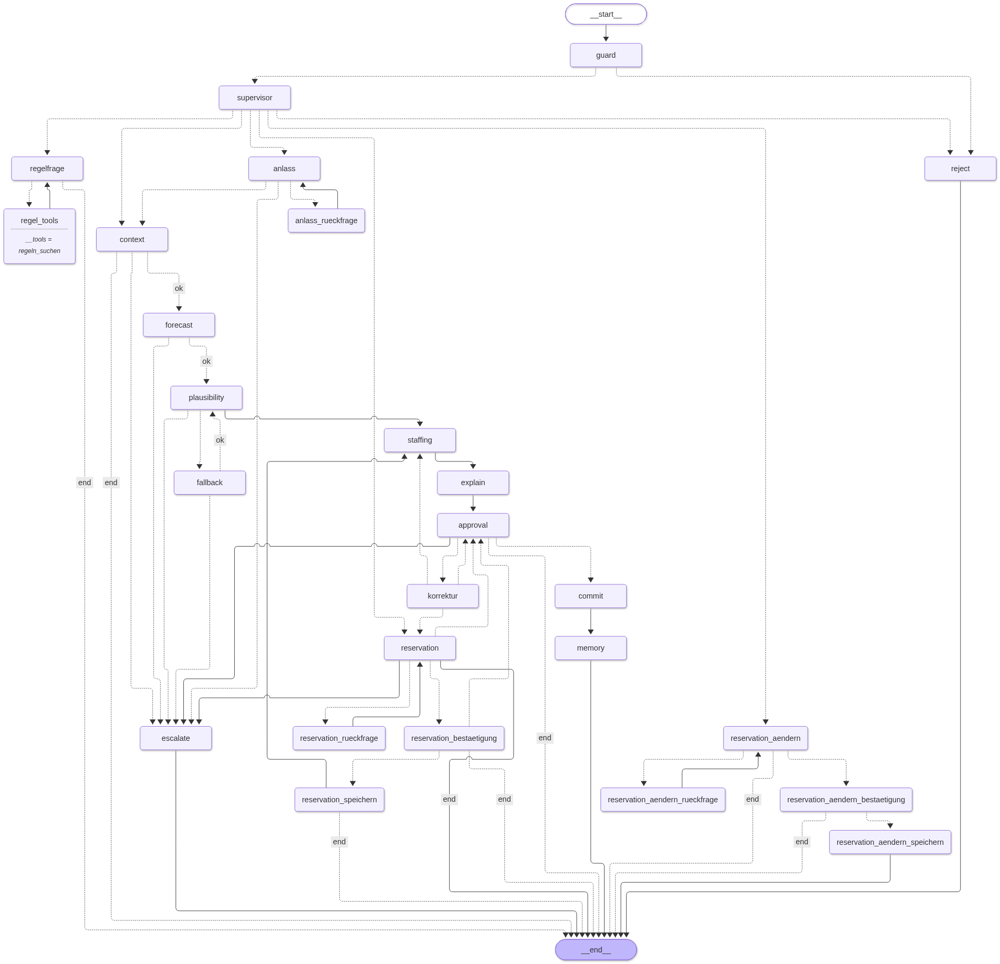

# gastroplanner

Restaurant-Personalplanungsagent · Generative KI und Agentensysteme · BSc Business Artificial Intelligence · FHNW Olten

Ein LLM-Orchestrator (LangGraph) holt Wetterprognose, Feiertage und Schulferien, lässt ein Regressionsmodell die Gästezahl der nächsten sieben Tage pro Schicht prognostizieren, leitet daraus die Besetzung für Küche, Service und Abwasch ab, begründet sie mit Quellen aus den Personalregeln und übernimmt den Plan erst nach Freigabe durch einen Menschen. Tischreservationen ab 10 Personen nimmt ein eigener Reservationsagent auf, ändert oder storniert sie; sie fliessen zusätzlich zur Prognose in die Planung ein. Eine bereits freigegebene Woche wird nicht neu geplant; ändert sich eine Reservation, muss ihr Plan neu freigegeben werden. Das LLM rechnet nie selbst.

**Problem:** Kleine Restaurants planen das Personal meist aus dem Bauchgefühl. Wetter, Feiertage, Schulferien und Gruppenanlässe verändern die Gästezahl aber deutlich; Unterbesetzung kostet Gäste und Nerven, Überbesetzung Lohn. Der Agent macht die Planung nachvollziehbar: Zahlen aus einem getesteten Prognosemodell, Regeln mit Quelle, Entscheid bei der Betriebsleitung.

| Dokument | Inhalt |
|---|---|
| [docs/konzept.md](docs/konzept.md) | Use-Case, User Stories, Prozess, Erfolgskriterien |
| [docs/architektur.md](docs/architektur.md) | Graph, State, Entscheide und Begründungen, Memory |
| [docs/modellwahl.md](docs/modellwahl.md) | Wahl des LLM |
| [eval/README.md](eval/README.md) | Testset und Evaluatoren |
| [data/readme.md](data/readme.md) | Synthetische Testdaten und eingebaute Effekte |

## Architektur



Gestrichelte Pfeile sind Verzweigungen (`agent/routing.py`), durchgezogene feste Kanten. Das LLM kommt nur in guard, supervisor, anlass, reservation, reservation_aendern, regelfrage, explain und korrektur vor; alle Zahlen stammen aus Tools. Begründungen: [docs/architektur.md](docs/architektur.md).

## Setup

```bash
git clone https://github.com/GenAI-BAI-2026HS/gastroplanner.git && cd gastroplanner
pip install -r requirements.txt
cp .env.example .env        # MODEL, API_KEY, LANGSMITH_API_KEY eintragen (BASE_URL ist vorausgefüllt)
python -m agent.check_gateway   # prüft Gateway, Modell und strukturierte Ausgabe
```

Den `API_KEY` erzeugt jede Person selbst in LiteLLM (Login über den Einladungslink mit dem FHNW-Konto). Welche Modelle verfügbar sind, zeigt `python -m agent.check_gateway --models`. Das Gateway ist eventuell nur im FHNW-Netz oder über VPN erreichbar. Die Testdaten (`data/restaurant.db`) liegen im Repo, die Prognosemodelle trainieren sich beim ersten Aufruf selbst.

## Starten und testen

```bash
streamlit run app.py             # Oberfläche im Browser (Demo)
python -m agent.run              # derselbe Agent im Terminal
python -m agent.run --mermaid    # Graph als Mermaid nach docs/graph.mmd
python -m agent.run --png        # Graph-Bild nach docs/graph.png (braucht Internet)
pytest                           # alle Tests, ohne API-Key und ohne Netzwerk
pytest -m "not mcp"              # ohne die Tests, die den MCP-Server starten
```

Schalter in `.env`: `USE_FIXTURES=1` nutzt die Beispieldaten in `tests/fixtures/` (Woche ab 26.10.2026) statt Wetterdienst und Datenbank, z. B. ohne Internet. `USE_MCP=0` ruft Wetter und Kalender direkt statt über den MCP-Server auf (nur für ein Deployment, in dem der MCP-Subprozess nicht startet).

Beispielanfragen (Demo-Ablauf):

1. «Plane die Woche ab Montag» → Plan mit Gästespanne, Annahmen und Freigabe-Buttons
2. «Am Donnerstag ist Stadtfest» → Rückfrage nach Personen und Schicht → «rechne mit 40 Gästen mehr, morgens» → Besetzung am Donnerstagmorgen steigt
3. «Reservation auf Meier, 12 Personen am Freitag um 12 Uhr» → Rückfrage nach der Telefonnummer → Bestätigung → «Speichern»; die Reservation erscheint in der Seitenleiste. Unter 10 Personen wird nichts erfasst.
4. «Wie lang darf eine Schicht höchstens dauern?» → Antwort mit Quelle
5. Beim Plan «Anpassen: Freitagnachmittag immer einen Service mehr» → neuer Plan → «Freigeben» → Plan und Korrektur erscheinen in der Seitenleiste
6. «Verschiebe die Reservation Meier auf 13 Uhr» → vorher/nachher → «Speichern»; ist die Woche schon freigegeben, wird ihr Plan als «muss neu freigegeben werden» markiert

## Repository

```
gastroplanner/
├─ config.py                 # Schichten, Rollen, Schlüssel, Standort, Pfade
├─ requirements.txt, .env.example, pytest.ini
├─ agent/                    # LangGraph-Orchestrator
│  ├─ graph.py               #   nur Verdrahtung
│  ├─ routing.py             #   alle Verzweigungen
│  ├─ state.py, schemas.py, prompts.py, llm.py
│  ├─ backends.py            #   Zugang zu forecast/, planning/, tools/ (USE_FIXTURES)
│  ├─ mcp_client.py          #   MCP-Server per stdio
│  ├─ run.py                 #   Kommandozeile
│  └─ nodes/                 #   ein Modul pro Themenbereich
├─ forecast/                 # train.py, predict.py, checks.py, baseline.py
├─ planning/staffing.py      # calculate_staffing
├─ tools/
│  ├─ weather.py, calendar_ch.py
│  ├─ plans.py               # approved_plans (gespeichert nur nach «Freigeben»)
│  ├─ reservations.py        # Reservationen erfassen, ändern, stornieren, Summen pro Schicht
│  ├─ rag.py, memory.py
├─ mcp_server/server.py      # FastMCP: Wetter + Kalender
├─ docs_rag/                 # Regeldokumente für RAG: personalregeln, anlaesse, betrieb
├─ eval/                     # Backtest, Modellvergleich, Agenten-Evaluation
├─ data/                     # generate.py, school_holidays.csv, restaurant.db
├─ tests/                    # pytest + fixtures/*.json
├─ docs/                     # Konzept, Architektur, Modellwahl, Graph-Bild, Backtest-Diagramm
├─ daten/, Skizze/           # Material aus dem früheren Konzept (siehe unten)
└─ app.py                    # Streamlit-Oberfläche
```

## Stand der Vertragsfunktionen

Alle Funktionen aus Projektplan Abschnitt 5 sind umgesetzt und getestet.

| Funktion | Datei |
|---|---|
| `get_weather`, `get_calendar` (Open-Meteo, Feiertage SO, Brückentage, Schulferien) | `tools/weather.py`, `tools/calendar_ch.py` |
| `forecast_guests` (OLS pro Schicht, 80 %-Prognoseintervall) | `forecast/predict.py` |
| `check_plausibility` | `forecast/checks.py` |
| Testdaten (Tabelle `history`) | `data/generate.py`, `data/school_holidays.csv` |
| Training, `load_models` (trainiert selbst, wenn `.pkl` fehlt) | `forecast/train.py` |
| `weekday_mean_forecast` (Fallback und Baseline im Backtest) | `forecast/baseline.py` |
| `calculate_staffing` | `planning/staffing.py` |
| `search_rules` (Hybrid: BM25 + optional Embeddings) | `tools/rag.py` |
| `save_correction`, `get_corrections` | `tools/memory.py` |
| `save_approved_plan`, `approved_plan_overlapping`, `plan_ungueltig_machen` | `tools/plans.py` |
| `save_reservation`, `update_reservation`, `delete_reservation`, `reserved_per_shift` (Erweiterung nach dem Projektplan) | `tools/reservations.py` |
| MCP-Server | `mcp_server/server.py` |
| LangGraph-Orchestrator | `agent/` |
| Streamlit-Oberfläche | `app.py` |

## Evaluation

| Was | Ergebnis | Details |
|---|---|---|
| Backtest Prognose (A4), 60 Tage nicht im Training | MAE 2.2 Gäste pro Schicht (8 %) gegenüber 3.7 (13 %) beim Wochentagsmittel, also 40 % weniger Fehler. 89 % der Ist-Werte liegen in der 80 %-Spanne. Unterbesetzte Schichten: 1 %. | [eval/ergebnisse_backtest.md](eval/ergebnisse_backtest.md), [docs/backtest.png](docs/backtest.png) |
| Regelsuche (C3), 24 Fragen | Hit@3 92 %, Hit@1 67 %, MRR 0.78 (BM25) | [eval/ergebnisse_rag.md](eval/ergebnisse_rag.md) |
| Agent (C6), 16 Fälle mit echtem LLM (`gpt-6-luna`) | 16/16 richtiges Ergebnis; Absicht 13/13, Anlass 1/1, Reservation 1/1, Quelle 3/3, Zahlen nur aus Tools 7/7. Ø 4.0 s pro Fall (Lauf vom 18.11. mit allen Reservationsfunktionen). | [eval/ergebnisse_agent.md](eval/ergebnisse_agent.md), LangSmith-Dataset `gastroplanner-testset-v2` |
| Modellwahl (B1), 5 gleiche Anfragen an 3 Modelle | Alle 5/5. Gewählt `gpt-6-luna` (auch 16/16 in C6, wenigste Tokens); Alternative `gpt-5.4-mini-new` (schneller); `claude-haiku-5-5` nur mit `temperature=1` und rund dreimal so viele Tokens | [docs/modellwahl.md](docs/modellwahl.md) |

```bash
python -m eval.backtest                      # A4, ohne API
python -m eval.rag_eval                      # C3, ohne API
python -m eval.agent_eval --langsmith        # C6, braucht Gateway und LangSmith
python -m eval.modellvergleich MODELL_A MODELL_B
```

## Limitationen

- **Synthetische Daten.** Die Gästehistorie ist generiert (`data/generate.py`) und enthält genau die Effekte, die das Modell als Merkmale bekommt. Der Vorsprung der Regression im Backtest ist deshalb optimistisch; in einem echten Restaurant kommen Effekte dazu, die das Modell nicht kennt (Baustellen, Konkurrenz, Bewertungen).
- **Wetter im Backtest gemessen, im Betrieb prognostiziert.** Der echte Prognosefehler ist grösser als im Backtest.
- **Personalschlüssel sind Annahmen** (P-01 bis P-04, `config.py`), nicht von einem Gastronomiebetrieb bestätigt.
- **Safeguarding ist prompt-basiert.** Der guard-Node ist ein LLM-Urteil und kann mit geschickten Formulierungen umgangen werden. Die Zahlen sind trotzdem geschützt, weil sie nicht vom LLM kommen. Zusätzlich blockiert der Inhaltsfilter des Anbieters (Azure OpenAI) offensichtliche Manipulationsversuche schon vor dem guard-Node (Testfall S3); der guard-Node wertet das als Ablehnung. Auf diesen Filter haben wir keinen Einfluss, er kann je nach Modell oder Anbieter fehlen.
- **Regelsuche ohne Embeddings nur mit Stichworten.** Zusammengesetzte Wörter und Synonyme findet BM25 schlecht; mit `EMBEDDING_MODEL` läuft die Hybrid-Suche.
- **Evaluation klein.** 16 selbst geschriebene Testfälle zeigen, dass die Abläufe funktionieren, sind aber keine statistisch belastbare Messung.
- **Wetter und Kalender werden pro Lauf doppelt abgerufen** (context-Node über MCP und intern in `forecast_guests`).
- **«Reservation ändern» nicht im LLM-Testset.** Das Ändern und Stornieren ist mit Unit-Tests abgedeckt (`tests/test_reservation_aendern.py`), aber nicht Teil der 16 Fälle mit echtem LLM.
- **Kein echtes Schichtsystem.** «Freigeben» speichert den Plan in einer Tabelle; Namen, Verfügbarkeiten und Arbeitszeitkonten der Mitarbeitenden sind nicht Teil der Lösung.

## Früheres Konzept (altes Material)

`daten/` (Testdaten-Generator mit Mittagsgeschäft, Mo–Fr, Kanton Zürich, Einkauf) und `Skizze/` (Mehragentensystem mit Einkaufsplanung) stammen aus dem Konzept vor dem Projektplan vom 19.10.2026. Der Projektplan legt zwei Schichten (morgen, nachmittag), Mo–Sa, Olten (Kanton SO) und nur Personalplanung fest. Die Testdaten nach Projektplan erzeugt `data/generate.py`; `config.DB_PATH` zeigt auf `data/restaurant.db`. `daten/` wird nicht mehr verwendet.
