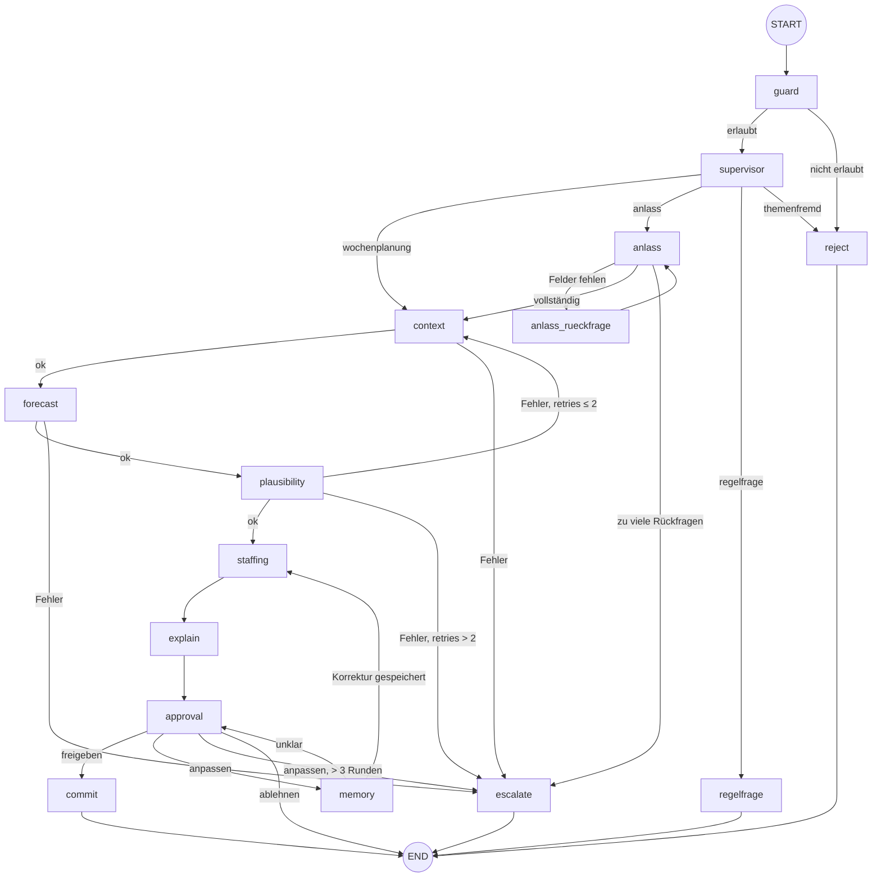

# Architektur des LangGraph-Orchestrators

Bezug: Projektplan Abschnitte 4–5, Aufgaben B4–B6, C3–C5 · Folien SW5 (Graph, State, strukturierte Ausgabe), SW6 (Tools, MCP).

## Grundprinzip

Das LLM rechnet nie selbst. Gästezahlen und Besetzung kommen aus Funktionen; das LLM versteht die Anfrage, wählt den Pfad, erfasst Anlässe aus Freitext, fragt nach und erklärt. Im Graphen ist das sichtbar: Die Planungskette `context → forecast → plausibility → staffing` enthält kein LLM.

## Organisation des Codes

| Datei | Inhalt | Regel |
|---|---|---|
| `agent/graph.py` | `add_node`, `add_edge`, `add_conditional_edges`, `compile` | nur Verdrahtung |
| `agent/routing.py` | alle Conditional-Edge-Funktionen | rein: State rein, Node-Name raus, kein LLM, kein I/O |
| `agent/nodes/*.py` | ein Modul pro Owner | dünn: eine Funktion oder ein LLM-Aufruf pro Node |
| `agent/backends.py` | einziger Zugang zu `forecast/`, `planning/`, `tools/` | Schalter `USE_FIXTURES` |
| `agent/state.py` | `AgentState`, `initial_state()` | Rohdaten, kein Fliesstext |
| `agent/schemas.py` | Pydantic-Modelle für `with_structured_output` | Literal-Typen statt freier Strings |
| `agent/prompts.py` | alle Prompts, Leitplanken von Helin | ein Ort für Prompt-Änderungen |
| `agent/mcp_client.py` | synchroner Wrapper um den MCP-Server | Fehlertext → Exception |

`agent/` importiert aus den Fachmodulen, nie umgekehrt. Prognose, Besetzung und RAG bleiben ohne LangGraph testbar.

## Graph

Automatisch erzeugt: `python -m agent.run --mermaid` schreibt `docs/graph.mmd`, `--png` schreibt `docs/graph.png`.

| Node | Typ | Owner | Modul |
|---|---|---|---|
| guard, reject | LLM (strukturiert) | Helin | `nodes/guard.py` |
| supervisor | LLM (strukturiert) | B | `nodes/supervisor.py` |
| regelfrage | LLM + RAG | Helin | `nodes/regelfrage.py` |
| anlass, anlass_rueckfrage | LLM (strukturiert), Mensch | B | `nodes/anlass.py` |
| context, forecast, plausibility, staffing | Tool, Regeln | B (ruft A, Helin) | `nodes/planung.py` |
| explain | LLM + RAG | B | `nodes/explain.py` |
| approval, commit | Mensch, Tool | B | `nodes/approval.py` |
| memory | LLM (strukturiert) | Helin | `nodes/memory.py` |
| escalate | Text | B | `nodes/ende.py` |

Gegenüber der Node-Tabelle im Projektplan neu: `reject` (gemeinsames Ende für guard und `themenfremd`), `anlass_rueckfrage` (eigener Node für den interrupt) und `escalate` als eigener Node.

## State

Basis ist der Vertrag aus Abschnitt 5. Ergänzt wurden Felder, die die Router brauchen:

| Feld | Gesetzt von | Gelesen von |
|---|---|---|
| `allowed` | guard | `route_after_guard` |
| `pending_event`, `anlass_versuche` | anlass, anlass_rueckfrage | `route_after_anlass` |
| `feedback` | approval | memory |
| `hinweis` | memory | approval (Anzeige), `route_after_memory` |
| `revisions` | memory | `route_after_approval` |
| `escalation` | context, forecast, anlass, escalate | `route_after_step`, `route_after_anlass` |
| `plan_id` | commit | App |

`initial_state()` setzt pro neuer Anfrage alle Laufzeitfelder zurück, weil der Checkpointer den State eines Threads behält. Nur der Nachrichtenverlauf wächst weiter.

## Entscheide und Begründungen

**Conditional Edges statt `Command(goto=...)`.** Die Ziele stehen explizit in `graph.py`, deshalb zeichnet `draw_mermaid()` alle Pfeile. Mit `Command` müsste man die Ziele zusätzlich annotieren.

**Mensch-Nodes enthalten nur den interrupt.** Beim Fortsetzen mit `Command(resume=...)` führt LangGraph den unterbrochenen Node von der ersten Zeile an erneut aus. Deshalb sind LLM-Extraktion (`anlass`) und Rückfrage (`anlass_rueckfrage`) getrennt, ebenso Freigabe (`approval`) und Speichern (`commit`). Die Rückfrage von `memory` läuft über `hinweis` zurück in `approval`.

**Graph synchron, MCP gekapselt.** Die MCP-Tools aus `langchain-mcp-adapters` sind nur asynchron aufrufbar. `agent/mcp_client.py` kapselt den Aufruf mit `asyncio.run`, damit Streamlit, `SqliteSaver` und pytest synchron bleiben. Pro Aufruf startet der Server kurz als Subprozess (zwei Aufrufe pro Lauf).

**MCP-Fehler werden zu Exceptions.** Getestet mit mcp 1.30: Ein Fehler im Tool wirft beim Client keine Exception, sondern liefert einen Textblock «Error executing tool …». `_as_records` erkennt das und wirft `MCPToolError`; der context-Node eskaliert dann, statt mit einer Fehlermeldung als Wetterdaten weiterzurechnen.

**Fehler im Node fangen, im Router entscheiden.** Deterministische Nodes schreiben `escalation`, statt eine Exception durchzureichen. Der Fehler ist im LangSmith-Trace sichtbar, und die Person bekommt eine Antwort.

**Fixtures über `agent/backends.py`.** Mit `USE_FIXTURES=1` läuft der Graph end-to-end, bevor A3, A5, C2, C3 und C5 fertig sind. Sobald eine Funktion fertig ist, `USE_FIXTURES=0` setzen; an den Nodes ändert sich nichts.

**Tabelle aus dem State, nicht aus dem LLM.** `explain` schreibt nur den Erklärtext. Die Besetzungstabelle zeigt die App direkt aus `state["staffing"]`. So kann das LLM die Zahlen nicht verändern.

## Grenzen (bekannt)

- **Wetter und Kalender werden doppelt abgerufen.** `forecast_guests` ruft sie laut Vertrag intern selbst ab, der `context`-Node zusätzlich über MCP.
- **Im Fixture-Modus wirken Anlässe und Korrekturen nicht auf die Besetzung.** Das leistet erst `calculate_staffing` (C2).
- **Der Fixture-Modus ignoriert das Startdatum.** Die Beispieldaten gelten für die Woche ab 26.10.2026.
- **Der explain-Node hat keine Tools.** Die Idee aus B3, dort Wetterfragen über MCP zu beantworten, wäre eine Ausbaustufe.

## Memory

| Art | Umsetzung | Gültigkeit |
|---|---|---|
| Kurzzeit | Checkpointer (`InMemorySaver` in Tests/CLI, `SqliteSaver` in der App) | ein Thread |
| Langzeit | Tabelle `corrections` über `tools/memory.py` | alle Läufe |
