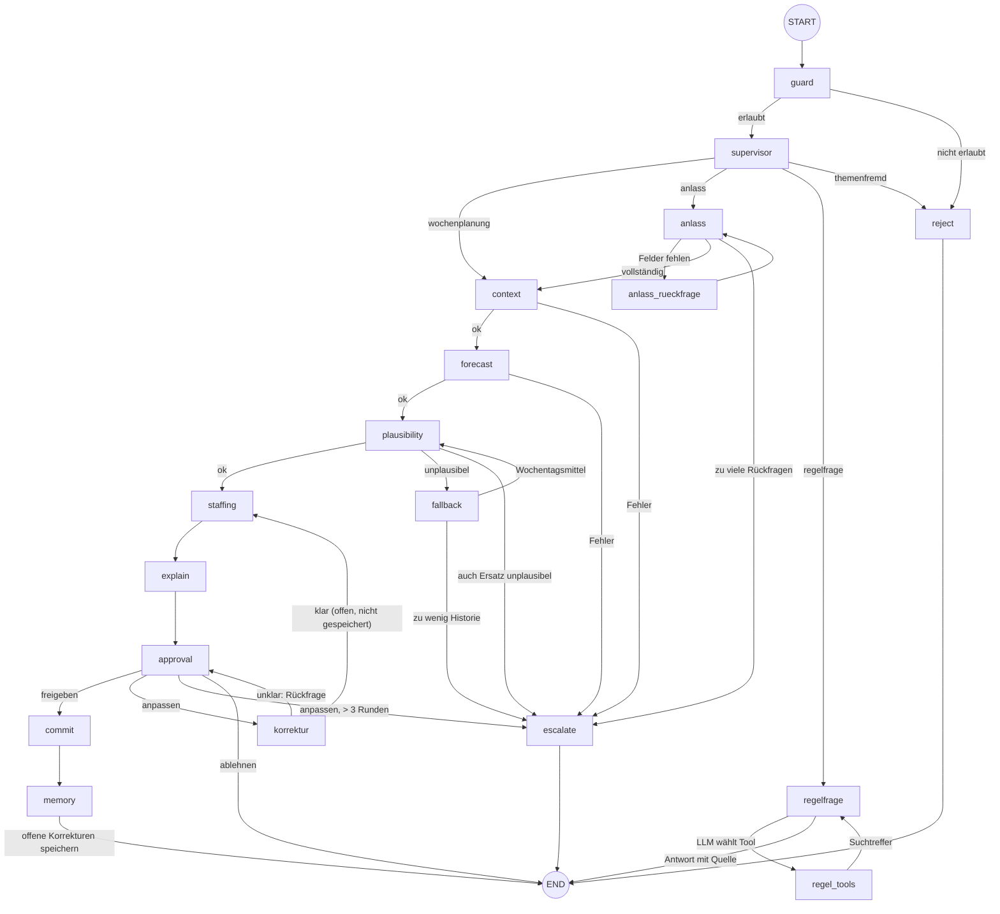

# Architektur des LangGraph-Orchestrators

Bezug: Projektplan Abschnitte 4–5, Aufgaben B4–B6, C3–C5 · Folien SW5 (Graph, State, strukturierte Ausgabe), SW6 (Tools, Function Calling, MCP).

## Grundprinzip

Das LLM rechnet nie selbst. Gästezahlen und Besetzung kommen aus Funktionen; das LLM versteht die Anfrage, wählt den Pfad, erfasst Anlässe aus Freitext, fragt nach und erklärt. Im Graphen ist das sichtbar: Die Planungskette `context → forecast → plausibility (→ fallback) → staffing` enthält kein LLM.

## Organisation des Codes

| Datei | Inhalt | Regel |
|---|---|---|
| `agent/graph.py` | `add_node`, `add_edge`, `add_conditional_edges`, `compile` | nur Verdrahtung |
| `agent/routing.py` | alle Conditional-Edge-Funktionen | rein: State rein, Node-Name raus, kein LLM, kein I/O |
| `agent/nodes/*.py` | ein Modul pro Themenbereich | dünn: eine Funktion oder ein LLM-Aufruf pro Node |
| `agent/backends.py` | einziger Zugang zu `forecast/`, `planning/`, `tools/` | Schalter `USE_FIXTURES` |
| `agent/state.py` | `AgentState`, `initial_state()` | Rohdaten, kein Fliesstext |
| `agent/schemas.py` | Pydantic-Modelle für `with_structured_output` | Literal-Typen statt freier Strings |
| `agent/prompts.py` | alle Prompts und Leitplanken | ein Ort für Prompt-Änderungen |
| `agent/mcp_client.py` | synchroner Wrapper um den MCP-Server | Fehlertext → Exception |

`agent/` importiert aus den Fachmodulen, nie umgekehrt. Prognose, Besetzung und RAG bleiben ohne LangGraph testbar.

## Graph

Automatisch erzeugt: `python -m agent.run --mermaid` schreibt `docs/graph.mmd`, `--png` schreibt `docs/graph.png`.

| Node | Typ | Modul |
|---|---|---|
| guard, reject | LLM (strukturiert) | `nodes/guard.py` |
| supervisor | LLM (strukturiert) | `nodes/supervisor.py` |
| regelfrage | LLM mit Tool-Wahl (`bind_tools`) | `nodes/regelfrage.py` |
| regel_tools | `ToolNode` (RAG-Suche `regeln_suchen`) | `nodes/regelfrage.py`, `tools/rag.py` |
| anlass, anlass_rueckfrage | LLM (strukturiert), Mensch | `nodes/anlass.py` |
| context, forecast, plausibility, fallback, staffing | Tool, Regeln | `nodes/planung.py` |
| explain | LLM + RAG | `nodes/explain.py` |
| approval, commit | Mensch, Tool | `nodes/approval.py` |
| korrektur, memory | LLM (strukturiert), Tool | `nodes/memory.py` |
| escalate | Text | `nodes/ende.py` |

Gegenüber der Node-Tabelle im Projektplan neu: `reject` (gemeinsames Ende für guard und `themenfremd`), `anlass_rueckfrage` (eigener Node für den interrupt) und `escalate` als eigener Node. Seit dem Review-Feedback ausserdem `fallback` (Wochentagsmittel statt Wiederholung), die Trennung von `korrektur` (extrahieren) und `memory` (speichern nach der Freigabe) sowie `regel_tools` (Tool-Calling in der Regelfrage).

## State

Basis ist der Vertrag aus Abschnitt 5. Ergänzt wurden Felder, die die Router brauchen:

| Feld | Gesetzt von | Gelesen von |
|---|---|---|
| `allowed` | guard | `route_after_guard` |
| `pending_event`, `anlass_versuche` | anlass, anlass_rueckfrage | `route_after_anlass` |
| `retries` | context, forecast (Wiederholungen bei Datenfehlern) | Trace, Tests |
| `fallback_grund` | forecast (zurücksetzen), fallback | `route_after_plausibility`, explain, approval (Anzeige) |
| `feedback` | approval | korrektur |
| `pending_corrections` | korrektur (anhängen), memory (leeren) | staffing, approval (Anzeige), memory |
| `hinweis` | korrektur | approval (Anzeige), `route_after_korrektur` |
| `revisions` | korrektur | `route_after_approval` |
| `escalation` | context, forecast, fallback, anlass, escalate | `route_after_step`, `route_after_anlass` |
| `plan_id` | commit | App |
| `regel_messages` | regelfrage, regel_tools (Tool-Schleife) | regelfrage, `route_after_regelfrage` |

`initial_state()` setzt pro neuer Anfrage alle Laufzeitfelder zurück, weil der Checkpointer den State eines Threads behält. Nur der Nachrichtenverlauf wächst weiter. `regel_messages` hat wie `messages` den Reducer `add_messages`; geleert wird es mit `RemoveMessage(id=REMOVE_ALL_MESSAGES)`.

## Entscheide und Begründungen

**Conditional Edges statt `Command(goto=...)`.** Die Ziele stehen explizit in `graph.py`, deshalb zeichnet `draw_mermaid()` alle Pfeile. Mit `Command` müsste man die Ziele zusätzlich annotieren.

**Mensch-Nodes enthalten nur den interrupt.** Beim Fortsetzen mit `Command(resume=...)` führt LangGraph den unterbrochenen Node von der ersten Zeile an erneut aus. Deshalb sind LLM-Extraktion (`anlass`) und Rückfrage (`anlass_rueckfrage`) getrennt, ebenso Freigabe (`approval`) und Speichern (`commit`). Die Rückfrage von `korrektur` läuft über `hinweis` zurück in `approval`.

**Korrekturen: lesen in `staffing`, schreiben nach der Freigabe.** Bei «anpassen» extrahiert `korrektur` das Feedback und legt es nur in `pending_corrections` ab. `staffing` ist die einzige Stelle, die Korrekturen liest: gespeicherte aus der Datenbank plus die offenen dieses Laufs. Die Person sieht den neu gerechneten Plan und die offenen Korrekturen in der Freigabe. Gespeichert wird erst im `memory`-Node nach `commit`. Bei «ablehnen» verfallen offene Korrekturen. So landet nie eine Korrektur im Langzeit-Memory, die zu einem verworfenen Plan gehört. Ist das Feedback unklar, geht eine Rückfrage über `hinweis` zurück an `approval`, weil dort der einzige interrupt sitzt; gespeichert wird dabei nichts.

**Wiederholen nur bei Datenfehlern, Fallback bei unplausibler Prognose.** Die Regression ist deterministisch: Derselbe Input liefert dasselbe Ergebnis, eine Wiederholung bringt nichts. Wiederholt wird deshalb nur, wo der Fehler ausserhalb unseres Codes liegt: `context` und `forecast` versuchen es bei Verbindungsfehlern, Timeouts und MCP-Fehlern bis zu dreimal mit wachsender Wartezeit (`planung.mit_wiederholung`), danach Eskalation. Programmfehler (z. B. `ValueError`) werden nicht wiederholt. Ist die Prognose unplausibel, rechnet `fallback` eine Ersatzprognose aus dem Mittel derselben Wochentage und Schicht der letzten 8 Wochen (`forecast/baseline.py`, gleiche Logik wie die Baseline im Backtest A4). Sie wird erneut geprüft; ist auch sie unplausibel, wird eskaliert. Die Schleife läuft also höchstens einmal. Erklärung und Freigabe nennen den Grund für den Fallback.

**Tool-Calling nur dort, wo die Wahl offen ist.** Der `context`-Node ruft Wetter und Kalender bewusst fest auf: Jede Wochenplanung braucht genau diese Daten, ein deterministischer Aufruf ist zuverlässiger und günstiger, als das LLM wählen zu lassen. In `regelfrage` ist die Wahl dagegen offen: Das LLM entscheidet, ob es sucht, mit welchen Stichworten und wie oft (z. B. eine Suche pro Thema). Umgesetzt mit `bind_tools`, einem `ToolNode` (`regel_tools`) und `tools_condition` im Router. Die Schleife ist auf `MAX_SUCHEN = 3` begrenzt; danach wird das Tool mit `tool_choice="none"` gesperrt. Der Verlauf der Schleife steht in `regel_messages`, nicht in `messages`, damit andere Nodes keine halben Tool-Aufrufe sehen. Das Tool liefert den Text fürs LLM und die Treffer als Daten (`content_and_artifact`); daraus entstehen die `rule_sources`.

**RAG als Hybrid-Suche.** `tools/rag.py` teilt die Dokumente in `docs_rag/` an den `##`-Überschriften: eine Regel pro Abschnitt, damit jede Quelle genau zitiert werden kann. Gesucht wird mit BM25 (Stichworte, lokal, deterministisch) und, wenn `EMBEDDING_MODEL` gesetzt ist, zusätzlich mit Chroma (Bedeutung). Beide Rankings werden mit Reciprocal Rank Fusion zusammengeführt. Ohne Embedding-Modell läuft nur BM25. `tests/test_rag.py` prüft, dass die Zahlen in `personalregeln.md` mit `config.py` übereinstimmen.

**Graph synchron, MCP gekapselt.** Die MCP-Tools aus `langchain-mcp-adapters` sind nur asynchron aufrufbar. `agent/mcp_client.py` kapselt den Aufruf mit `asyncio.run`, damit Streamlit, `SqliteSaver` und pytest synchron bleiben. Pro Aufruf startet der Server kurz als Subprozess (zwei Aufrufe pro Lauf).

**MCP-Fehler werden zu Exceptions.** Getestet mit mcp 1.30: Ein Fehler im Tool wirft beim Client keine Exception, sondern liefert einen Textblock «Error executing tool …». `_as_records` erkennt das und wirft `MCPToolError`; der context-Node eskaliert dann, statt mit einer Fehlermeldung als Wetterdaten weiterzurechnen.

**Fehler im Node fangen, im Router entscheiden.** Deterministische Nodes schreiben `escalation`, statt eine Exception durchzureichen. Der Fehler ist im LangSmith-Trace sichtbar, und die Person bekommt eine Antwort.

**Fixtures über `agent/backends.py`.** Mit `USE_FIXTURES=1` läuft der Graph end-to-end, bevor A3, A5, C2, C3 und C5 fertig sind. Sobald eine Funktion fertig ist, `USE_FIXTURES=0` setzen; an den Nodes ändert sich nichts.

**Tabelle aus dem State, nicht aus dem LLM.** `explain` schreibt nur den Erklärtext. Die Besetzungstabelle zeigt die App direkt aus `state["staffing"]`. So kann das LLM die Zahlen nicht verändern.

## Grenzen (bekannt)

- **Wetter und Kalender werden doppelt abgerufen.** `forecast_guests` ruft sie laut Vertrag intern selbst ab, der `context`-Node zusätzlich über MCP.
- **Im Fixture-Modus wirken Anlässe nicht auf die Besetzung, Korrekturen nur vereinfacht** (`backends._apply_corrections`, nie unter Mindestbesetzung). Die echte Logik leistet erst `calculate_staffing` (C2).
- **Die Ersatzprognose braucht die Tabelle `history`** (A2). Fehlt sie oder hat sie zu wenig Werte, eskaliert der Graph.
- **Der Fixture-Modus ignoriert das Startdatum.** Die Beispieldaten gelten für die Woche ab 26.10.2026.
- **Die Stichwortsuche kennt keine Synonyme.** Ohne Embedding-Modell findet sie nur Wörter, die im Dokument stehen. Die Regeltexte nennen deshalb gängige Begriffe ausdrücklich (z. B. «Köchinnen und Köche», «Feierabend»).
- **Der explain-Node hat keine Tools.** Die Idee aus B3, dort Wetterfragen über MCP zu beantworten, wäre eine Ausbaustufe.

## Memory

| Art | Umsetzung | Gültigkeit |
|---|---|---|
| Kurzzeit | Checkpointer (`InMemorySaver` in Tests/CLI, `SqliteSaver` in der App) | ein Thread |
| Langzeit | Tabelle `corrections` über `tools/memory.py`; gelesen in `staffing`, geschrieben in `memory` nach der Freigabe | alle Läufe |
